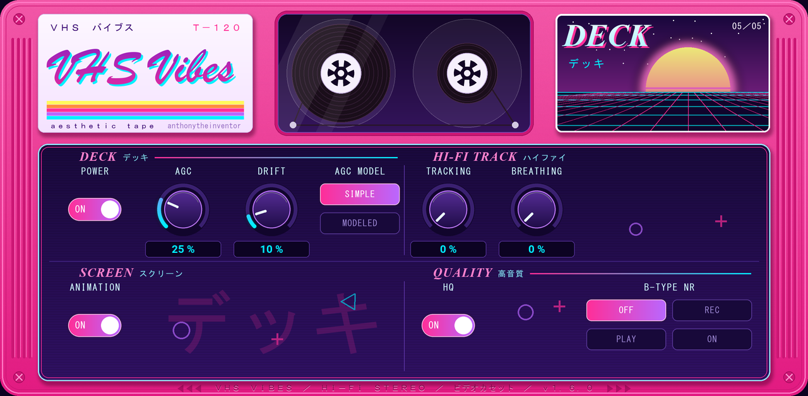

<p align="center">
  
</p>

<h1 align="center">ＶＨＳ　ＶＩＢＥＳ</h1>

<p align="center">
  <b>ビデオカセット　・　ａｅｓｔｈｅｔｉｃ　ｔａｐｅ　ｄｅｇｒａｄａｔｉｏｎ　・　Ｔ－１２０</b><br>
  an effect plugin for Akai MPC standalone hardware, by anthonytheinventor
</p>

> *You found this tape in a box with no label. Somebody recorded over it, twice.*
> *The picture is gone. The sound stayed. It is not the sound that went in.*

---

## ▶ ＰＬＡＹ

**VHS Vibes makes clean audio sound like it lived on a video cassette.** Put it on a track and
the pitch starts to swim, the highs soften, the hiss comes up in the quiet parts and, if you
let it, the machine loses the tape for a moment and finds it again.

- insert effect, stereo in, stereo out
- 49 controls on five pages, 21 built-in programs
- a hot pink cassette on the MPC's screen, with reels that turn when sound passes
- every noise is synthesised: no samples, nothing to load
- version 1.3

## ⏏ ＩＮＳＥＲＴ　ＴＡＰＥ

1. Take the zip from [Releases](https://github.com/anthonytheinventor/vhs-vibes/releases).
2. Copy the folder `anthonytheinventor - VST - VHS Vibes` into a folder named `VST2 Plugins`
   at the top of a USB drive, an SD card or the MPC's internal drive.
3. On the MPC: **Preferences > Enhancements (Beta)**, switch on **Enable Enhancements** and
   **External Plugin Support**. Restart the MPC.
4. It is in the plugin browser under **External Plugins**.

Needs MPC OS 3.10.1 or later. `INSTALL.txt` in the zip says the same at more length.

## 📼 ＷＨＡＴ　ＩＳ　ＯＮ　ＴＨＥ　ＴＡＰＥ

The sound goes through the machine in this order:

```
in -> Chorus -> Mic -> AGC -> Preamp (Tone, Drive) -> Wear -> Comp -> 2-band Saturator -> Hi Cut
   -> Wobble 1 (Warp, Flutter) -> Noise -> Wobble 2 (Wow, Flutter) -> Lo Cut / Hi Cut
   -> Drift -> Tracking -> Head switching -> Dropouts -> Mono -> Mix -> Output
```

Two wobbles, because a copy of a copy wobbles twice. Each block of four controls on screen
is one Q-Link group: touch a control and the four knobs follow that block.

### ＴＡＰＥ　テープ

*What the tape did to the sound.*

| Control | What it does |
|---|---|
| Drive | Preamp soft clipping. 0 % is clean. |
| Tone | Tilt: left is darker, right is brighter (about 6 dB each way). |
| Wear | Limits how fast the signal can change: dulls and smears, like an old or copied tape. |
| Comp | One-knob compressor. Past about a third it squashes and brings quiet sound (and noise) up. |
| Dropouts | Short random level dips. 0 % is off. |
| Mono | Sums left and right. |
| Mix | Dry / wet. 100 % (the default) is all effect; lower lets the untouched input back in. |
| Output | Output level. |
| Saturator Power | Switches the 2-band saturator. |
| Split | Where the signal is divided into lows and highs. |
| Lows / Lo Sat | Level and clipping of the low band. |
| Highs / Hi Sat | Level and clipping of the high band. Lower Highs and raise Hi Sat for "copied again". |
| Hi Cut | 4-pole lowpass after the saturator. |

### ＷＯＢＢＬＥ　ゆらぎ

*The motor is tired.*

| Control | What it does |
|---|---|
| Warp | Depth of the slow pitch wobble (up to about 5 % of pitch). |
| RPM | Speed of the slow wobble, as reel turns per minute. Below about 30 rpm the depth is limited. |
| Shape | 0 % is a smooth wobble, 100 % an uneven lurch. |
| Flutter Depth / Rate | Fast pitch wobble. |
| Wow, Rate, Flutter, Rate (Re-record) | A second, independent wobble: the tape after one more copy. |
| Lo Cut / Hi Cut | Filters after the second wobble. |
| Wobble (switch) | Turns both wobbles off or on together. The filters stay in. |

### ＮＯＩＳＥ　ノイズ

*Everything the tape adds when nobody is talking.*

| Control | What it does |
|---|---|
| Hum | 60 Hz mains hum. |
| Buzz | 120 Hz buzz. |
| Head Buzz | The video heads switching, 59.94 times a second: a steady rasp, plus a buzz that rides on bright sounds and vanishes on bass (the signal is held for a few samples at each switch). |
| Hiss | Tape hiss (different in left and right). |
| Crackle | Random clicks; the knob sets both how many and how loud. |
| Master | Level of all noise together. 50 % is nominal, 0 % is silent. |
| Noise (switch) | Turns all noise off or on. |
| Position | Post: noise is added after the first wobble (clean noise). Pre: noise goes in at the input and is compressed, clipped and wobbled with the music. |

### ＩＮＰＵＴ　インプット

*What it was recorded through.*

| Control | What it does |
|---|---|
| Chorus Power, Mix, Speed, Delay, Width | A chorus in front of everything; Width spreads it left / right. |
| Mic Power, Type, Gain | The tone of re-recording through a cheap microphone: Camcorder, Dynamic, Phone or Boombox. |

### ＤＥＣＫ　デッキ

*Faults of the machine rather than the tape. Each does something no other control can.*

| Control | What it does |
|---|---|
| Power | The whole deck section on or off. |
| AGC | The recorder's automatic level control. A loud sound pulls the gain down at once; it stays down for a second and a half, then creeps back up over a few seconds and brings the background up with it (up to 14 dB). Comp works in milliseconds; this works in seconds. |
| Drift | The sound slowly comes and goes: quieter and duller for a moment, then back, like the audio track wandering off the head. (Dropouts are short dips; this is slow.) |
| Tracking | The Hi-Fi track loses lock now and then: a burst of static, a moment on the dull mono backup track, another burst, back again. Higher is more often. |
| Breathing | The hiss rises and falls with the signal, like a mistracking noise-reduction circuit. |
| Animation | The moving reels, grid and sun on or off. Off saves the work of updating the screen. Choosing a program does not change it. |

There is no tape-speed or track switch because they would only repeat other controls. For a
slow-speed (EP) tape set Hi Cut near 6 kHz, Lo Cut near 100 Hz and raise Hiss; SP is about
10 kHz and 50 Hz. For a clean Hi-Fi sound keep the wobbles and the noise low.

<p align="center">
  
</p>

## 🗃 ＴＡＰＥＳ　ＩＮ　ＴＨＥ　ＢＯＸ

Twenty-one programs. The labels are handwritten.

| Program | What is on it |
|---|---|
| Home Recording | The default. A family tape in good shape: gentle wobble, some hiss, a level control that rides a little. |
| Fresh Rental | Friday night, new release. Clean, a trace of breathing, loses lock once in a long while. |
| 3rd Gen Copy | A copy of a copy of a copy: dull, clipped highs, deep wobble, plenty of noise. |
| Vaporwave Mall | Slow warble and a wide chorus under dimmed lights. |
| Camcorder 89 | Built-in microphone, level control squashing everything, noise recorded with the picture. |
| Tracking Error | Buzz on the music, static, and the sound dropping to the backup track. |
| Late Night TV | Mono, narrow, hum from the studio. |
| Clean Widener | No tape at all: only the chorus, used as a stereo widener. |
| Training Video | Please watch carefully. Mono, hiss that swells in every pause, slow warble, head buzz. |
| Chewed Tape | The machine ate it. Lurching pitch, dropouts, sound that comes and goes. |
| Answer Machine | You have one new message. Telephone tone, narrow and squashed. |
| Dream Sequence | Wide, slow and hazy, with hardly any noise. |
| Subtle Glue | Just a little tape: gentle clipping, the faintest wobble, no noise. |
| Bad Tracking | A good tape in a deck that cannot quite follow it. |
| Six Hour Tape | Recorded at the slowest speed: about 100 Hz to 6 kHz, more hiss, more wobble. |
| Wedding Video | A camcorder at the back of the hall; the level control rides everything. |
| Hi-Fi Master | The best VHS could do: wide, steady, quiet, breathing a little. |
| Edge Damage | The top edge of the tape is creased: the sound comes and goes. |
| Bootleg Concert | Taped from the crowd on a boombox and copied a few times. |
| Public Access | Local cable studio: hum, buzz, and a level control doing its best. |
| Init | A blank tape. Everything neutral; the sound passes through unchanged. Always the last one. |

## 👁 ＩＴ　ＭＯＶＥＳ

- The two reels turn while sound comes in or the song is playing, coast to a stop about two
  seconds after, and lurch with the wobble.
- The neon grid on the page sticker rolls with the reels.
- The sun glows with the output level.

These are driven by two extra read-only parameters, Reel and Level, which the plugin updates
up to 20 times a second. They are not settings, cannot be automated and are best left alone.
The Animation switch on the DECK page turns them off.

## 📝 ＮＯＴＥＳ　ＦＲＯＭ　ＴＨＥ　ＢＡＣＫ　ＯＦ　ＴＨＥ　ＢＯＸ

- With Position on Pre and Comp or AGC turned up, the noise swells whenever the music stops.
  That is how a real recorder's level control behaves; turn Master down if it is too much.
- The effect makes noise even with no input. Set Master to 0 %, or switch Noise off, for a
  silent background.
- Turning a wobble depth or rate changes the plugin's own delay for a moment, which bends
  the pitch while you turn it.
- Mix below 100 %: the dry signal is delayed to line up with the tape path. With the wobbles
  off the blend is clean; with them on, dry and wet drift against each other and it sounds
  like a chorus. That is the nature of mixing a wobbling signal with a steady one.
- The pictures in `docs/` are mock-ups drawn by the skin script, not photos of an MPC.

## ⏪ ＲＥＷＩＮＤ　巻き戻し

For those who want to open the cassette.

This repository is the plugin's project folder for the
[Akai MPC Plugin SDK](https://github.com/inmusic-software/mpc-plugin-builder-sdk). Clone the
SDK and put this folder inside it as `plugins/VHS Vibes`.

**Build** (Linux or WSL):

```
python3 "plugins/VHS Vibes/tools/build_lto.py" "plugins/VHS Vibes"
```

This is the SDK's `tools/build.py` with link-time optimisation (`-flto`) added; all its
options work. The plain `tools/build.py` also builds the plugin, without LTO.

Left and right run through the effect chain together as one two-float vector, which the
compiler turns into NEON instructions on the MPC. A stage whose amount is zero is skipped,
and maths that would be a library call on the 32-bit MPCs (fmax, tanh, sin per sample) is
kept out of the per-sample code.

**Skin.** The interface is a hand-made skin: a hot pink cassette with the reel window and two
stickers along the top and the controls on a dark face label, in two rows of eight. The
block titles start a little to the right so the MPC's "Q" marker does not cover them. It is
generated by a script (needs Python with Pillow, on Windows for the fonts):

```
python "plugins/VHS Vibes/tools/make_skin.py"
```

It reads `build/params.json` (run a build first, `--target native` is enough), draws every
picture and writes `skins/TUI.json` and `skins/Q-Links.json`. `tools/build.py` copies
`skins/` into the plugin as it is. Mock-ups of each page are written to `build/preview/`.
`ui.json` is not used while `skins/` exists; it is a plain fallback layout.

Captions and titles are part of the pictures, because the MPC can only draw live text in
three built-in fonts. They were rendered from fonts installed with Windows and Office
(MS Gothic, Times New Roman, Brush Script MT). No font files are in the plugin. The value
read-outs under the knobs are live text (Nexa).

**Tests** (Linux or WSL, needs zig):

```
bash "plugins/VHS Vibes/tests/run.sh"
```

Builds four small programs and runs them on the computer: `host_test` (what the plugin tells
the host and when), `mix_test`, `deck_test` and `levels_test` (measurements of each stage to
read through). The first two end in PASS or FAIL.

## 🔍 ＦＩＮＥ　ＰＲＩＮＴ

- Built for 32-bit and 64-bit MPCs; passes the SDK host simulator (the one warning, sound
  with silent input, is the noise section doing its job).
- Tested on an MPC One+, every version from 1.0 to 1.3.
- A plugin runs inside the MPC software. A faulty one can freeze or crash the MPC, and
  third-party plugins are not supported by inMusic / Akai. Save your project first.
- What comes from real VCR data: heads switch every video field (59.94 Hz); a Hi-Fi deck
  that loses its carrier makes static and falls back to the mono linear track; camcorder
  level controls duck fast, hold for seconds and creep back; Hi-Fi noise reduction breathes.
  The times and depths of those effects are not documented anywhere I could find and are
  set by ear.
- CPU: about 0.2 % of one core on a desktop PC for the default program. The 32-bit MPCs are
  much slower; no figure for them is recorded here. Stages whose amount
  is zero are skipped, so clean settings cost less: Init takes about a third of Home Recording.
- Latency: the two wobble stages hold the sound back by their resting length: 12 samples
  with the wobbles off, about 5 ms on Home Recording, more with slow, deep wobble. The plugin
  reports that length to the host half a second after it stops changing.
- After a program change the output is shut for the length of the delays and then fades in
  over about 20 ms, so presets switch without a click or a pitch slide.
- The sample rate is not assumed, but only 44.1 kHz has been tested.

**Credits.** The order of the stages follows the idea of James Peck's "VHS Audio Degradation
Suite" for Reaktor. That ensemble is not used, copied or required: all code here is original.

**Licence.** MIT, see [LICENSE](LICENSE).

<p align="center"><i>ｂｅ　ｋｉｎｄ　・　ｒｅｗｉｎｄ</i></p>
