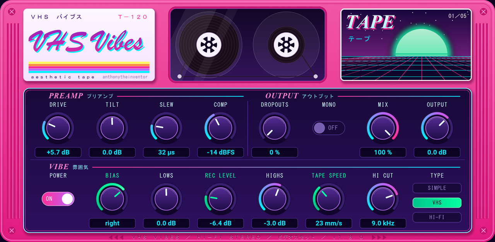
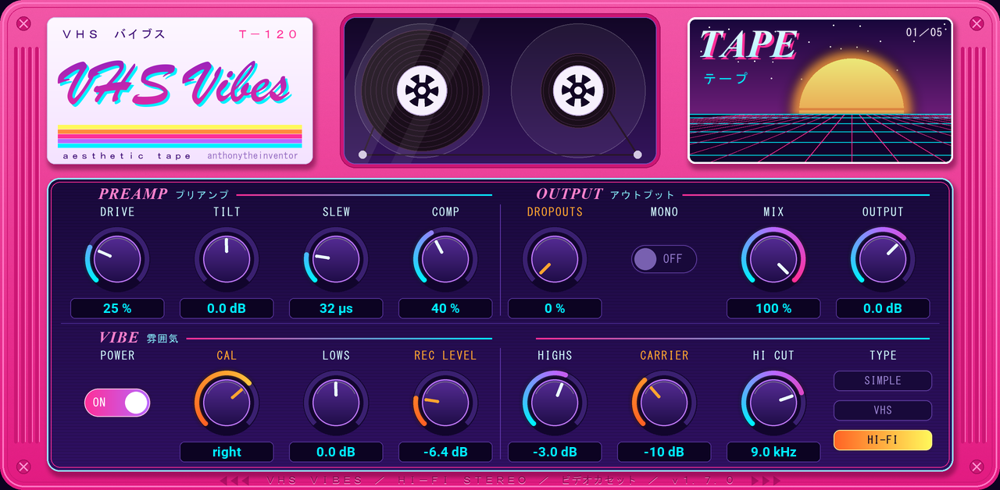
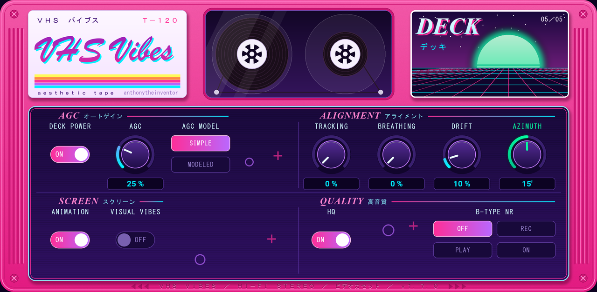
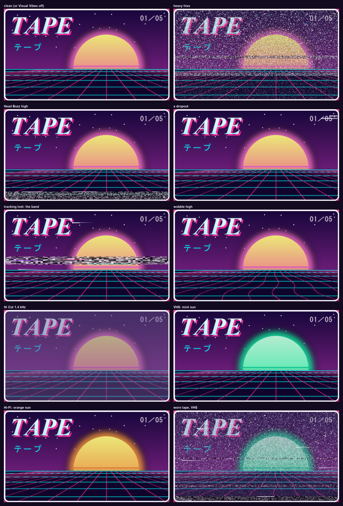

<p align="center">
  
</p>

<h1 align="center">ＶＨＳ　ＶＩＢＥＳ</h1>

<p align="center">
  <b>ビデオカセット　・　ａｅｓｔｈｅｔｉｃ　ｔａｐｅ　ｄｅｇｒａｄａｔｉｏｎ　・　Ｔ－１２０</b><br>
  an effect plugin for Akai MPC standalone hardware, by anthonytheinventor
</p>

> *You found this tape in a box with no label. Somebody recorded over it, twice.*
> *The picture is gone. The sound stayed. It is not the sound that went in.*

---

## ▶ ＰＬＡＹ

**VHS Vibes makes clean audio sound like it lived on a video cassette.** Put it on a track and
the pitch starts to swim, the highs soften, the hiss comes up in the quiet parts and, if you
let it, the machine loses the tape for a moment and finds it again.

- insert effect, stereo in, stereo out
- 58 controls on five pages, 46 built-in programs
- three tape types: Simple, VHS (the linear track) and Hi-Fi (the FM track)
- a hot pink cassette on the MPC's screen, with reels that turn when sound passes, and a picture that can show the sound
- every noise is synthesised: no samples, nothing to load
- version 1.7

## ⏏ ＩＮＳＥＲＴ　ＴＡＰＥ

1. Take the zip from [Releases](https://github.com/anthonytheinventor/vhs-vibes/releases).
2. Copy the folder `anthonytheinventor - VST - VHS Vibes` into a folder named `VST2 Plugins`
   at the top of a USB drive, an SD card or the MPC's internal drive.
3. On the MPC: **Preferences > Enhancements (Beta)**, switch on **Enable Enhancements** and
   **External Plugin Support**. Restart the MPC.
4. It is in the plugin browser under **External Plugins**.

Needs MPC OS 3.10.1 or later. `INSTALL.txt` in the zip says the same at more length.

## 📖 ＲＥＡＤ　ＴＨＥ　ＭＡＮＵＡＬ

Every control, every program and what the machine is doing inside:
[VHS-Vibes-Manual.pdf](https://github.com/anthonytheinventor/vhs-vibes/blob/main/manual/VHS-Vibes-Manual.pdf).

## ☕ ＴＩＰ　ＪＡＲ

VHS Vibes is free. If it ends up on your tracks, you can leave a tip at
[ko-fi.com/anthonytheinventor](https://ko-fi.com/anthonytheinventor). It keeps the VCR running.

## 📼 ＷＨＡＴ　ＩＳ　ＯＮ　ＴＨＥ　ＴＡＰＥ

The sound goes through the machine in this order:

```
in -> Chorus -> Mic -> AGC -> Preamp (Tilt, NR record side, Drive) -> Slew -> Comp
   -> Vibe (Simple, VHS or Hi-Fi) -> Hi Cut
   -> Wobble 1 (Warp, Flutter, Scrape) -> Noise -> Wobble 2 (Wow, Flutter) -> Lo Cut / Hi Cut
   -> Drift -> Tracking -> Head Buzz -> Whistle -> Dropouts -> NR playback side -> Mono -> Mix -> Output
```

Two wobbles, because a copy of a copy wobbles twice. Each block of four controls on screen
is one Q-Link group: touch a control and the four knobs follow that block.

### ＴＡＰＥ　テープ

*What the tape did to the sound.*

| Control | What it does |
|---|---|
| Drive | Preamp soft clipping. 0 % is clean. |
| Tilt | Tilts lows against highs around 800 Hz: left is darker, right is brighter. Reads as what the highs get, -6.0 to +6.0 dB. |
| Slew | A slew limiter: limits how fast the signal can move, which dulls and smears loud, bright sound like an old or copied tape. Reads as the shortest time left for a swing from silence to full level, from 12 to 1890 µs; off at the bottom. |
| Comp | One-knob compressor. Past about a third it squashes and brings quiet sound (and noise) up. |
| Dropouts | Short random dips, as when the tape lifts off the head: the highs go first and furthest, the lows only sag. 0 % is off. |
| Mono | Sums left and right. |
| Mix | Dry / wet. 100 % (the default) is all effect; lower lets the untouched input back in. |
| Output | Output level. |
| Power (VIBE) | Switches the VIBE stage, whichever Type is chosen. The MPC lists it as Saturator. |
| Split | Where the signal is divided into lows and highs. |
| Lows / Lo Sat | Level and clipping of the low band. |
| Highs / Hi Sat | Level and clipping of the high band. Lower Highs and raise Hi Sat for "copied again". |
| Hi Cut | 4-pole lowpass after the VIBE stage. |
| Sat Type | Three stacked buttons. **Simple**: the two-band saturator described above (called 2-Band up to 1.6). **VHS**: the tape of a VHS deck's linear track. **Hi-Fi**: the FM sound the video heads write under the picture. VHS and Hi-Fi give some knobs new jobs (below). |

**Sat Type = VHS**

This is the linear track: quiet sound passes unchanged, loud sound loses its highs first and goes soft,
the way slow tape does. Three knobs change their meaning, their caption on the screen and the number under
them, and turn mint green with the VHS button, so you can see which controls the mode has taken over. The
MPC still lists them as Split, Lo Sat and Hi Sat.

| Knob | Becomes | Reads | What it does |
|---|---|---|---|
| Lo Sat | **Rec Level** | dB | The record level, from 10 dB under to 8 dB over the deck's reference level, which is at 56 %. There a tone at -8 dBFS has 3 % distortion, as on a real deck. Quiet sound comes back at the level it went in whatever the setting; what changes is how much of the loud sound the tape bends. |
| Hi Sat | **Tape Speed** | SP, LP, EP and other formats' speeds by name, the speed in mm/s between them | From SP (0 %) to EP (100 %). The slower, the sooner the highs give way and the lower the top of the band. |
| Split | **Bias** | "right", or a signed percentage (minus is too little) | How well the deck is set up for the tape. 2.5 kHz, where the knob rests, is right. Lower is too little bias: brighter, grittier, distorting sooner. Higher is too much: duller, the highs giving way sooner. |

Lows and Highs still trim the result, below and above 1 kHz. Tape Speed also names the speeds of
other formats that fall inside its range; the sound at each is the VHS tape at that speed:

| Name | Speed | Knob |
|---|---|---|
| PAL SP | 23.39 mm/s | 32 % |
| Beta II | 20.00 mm/s | 47 % |
| PAL Beta | 18.73 mm/s | 53 % |
| LP | 16.67 mm/s | 63 % |
| Beta III | 13.33 mm/s | 83 % |
| PAL LP | 11.70 mm/s | 95 % |

<p align="center">
  
</p>

**Sat Type = Hi-Fi**

The FM sound the spinning video heads write under the picture. It does not saturate: it stays clean up
to a hard ceiling. What you hear is everything around it: hiss that rises and falls with the music, clicks
when the signal off the tape is weak, the heads switching, and drops to the dull mono linear track when the
signal is lost. It is a real Hi-Fi deck's machinery, driven far out of spec, with the click amount given its
own knob. The bottom of each knob is a deck in good order.

Three knobs on this page take new jobs:

| Knob | Becomes | Reads |
|---|---|---|
| Lo Sat | **Rec Level** | -10 to +28 dB |
| Hi Sat | **Carrier** | 0 to -20 dB |
| Split | **Cal** | "right", ±3 dB |

- **Rec Level**: how hard the sound meets the hard ceiling. 0 dB at 56 %. Drum hits after
  silence touch it even low on the knob; that is the format.
- **Carrier**: how strong the signal off the tape is. Each dB down is a dB more hiss. From
  about -14 dB the deck falls to the linear track now and then; from about -19 dB it hardly
  comes back. Each fall lasts about a quarter of a second, with its own hiss.
- **Cal**: playback set to a different level from recording. Off "right", the error comes out
  doubled and grows with the level: the sound pumps.

With VIBE's power on, seven more knobs belong to the Hi-Fi track, and B-Type NR is ignored:

| Knob | In Hi-Fi |
|---|---|
| Hiss | FM noise; breathes by itself |
| Crackle | how many clicks |
| Head Buzz | the head switch, badly hidden |
| Breathing | another deck's playback: pumps |
| Tracking | a weak head, signal dips |
| Drift | the signal wandering slowly |
| Dropouts | short losses of the signal |

Crackle is the amount of clicks only: Carrier does not move it. All ten knobs and the HI-FI
button turn sunset orange. With VIBE's power off, all seven are their own again.

<p align="center">
  
</p>

### ＷＯＢＢＬＥ　ゆらぎ

*The motor is tired.*

| Control | What it does |
|---|---|
| Warp | Depth of the slow pitch wobble (up to about 5 % of pitch). |
| Warp Rate | Speed of the slow wobble, 0.10 to 5.00 Hz. With Warp high, the slowest speeds hold the depth back (at Warp 100 % below about 0.38 Hz; below Warp 50 % never). |
| Shape | 0 % is a smooth wobble, 100 % an uneven lurch. |
| Flutter Depth / Rate | Fast pitch wobble. |
| Scrape | Scrape flutter: the tape sticking and slipping along its path, far faster than any wobble. A roughness that clings to bright sounds and is silent in silence. 0 % is off. |
| Wow, Rate, Flutter, Rate (Re-record) | A second, independent wobble: the tape after one more copy. With Wow high, the slowest rates hold its depth back (at Wow 100 % below about 0.23 Hz; below Wow 65 % never). |
| Lo Cut / Hi Cut | Filters after the second wobble. |
| Wobble (switch) | Turns both wobbles and Scrape off or on together. The filters stay in. |

### ＮＯＩＳＥ　ノイズ

*Everything the tape adds when nobody is talking.*

| Control | What it does |
|---|---|
| Hum | 60 Hz mains hum. |
| Buzz | 120 Hz buzz. |
| Head Buzz | The video heads switching, 59.94 times a second: a steady rasp, plus a buzz that rides on bright sounds and vanishes on bass (the signal is held for a few samples at each switch). |
| Hiss | Tape hiss (different in left and right). |
| Crackle | Random clicks; the knob sets both how many and how loud. |
| Whistle | The line whistle of the TV set, 15.7 kHz, steady, never wobbling. About where a real deck has it at 50 %; above 60 % it climbs fast, to a set that screams. Not everyone can hear it. |
| Master | Level of all noise together. 50 % is nominal, 0 % is silent. |
| Noise (switch) | Turns all noise off or on. |
| Position | Post: noise is added after the first wobble (clean noise). Pre: noise goes in at the input and is compressed, clipped and wobbled with the music. |

### ＩＮＰＵＴ　インプット

*What it was recorded through.*

| Control | What it does |
|---|---|
| Chorus Power, Mix, Speed, Delay, Width | A chorus in front of everything; Width spreads it left / right. |
| Mic | Plays the sound into a period microphone before the recorder, as if re-recorded through it. On Modeled it adds the microphone's own noise (silenced by the Noise switch). |
| Mic Type | Camcorder, Dynamic, Phone or Boombox. What each one is depends on Mic Model (below). |
| Mic Gain | On Simple, the level of the microphone, after its curve. On Modeled, how loud the sound is at the microphone, before it: a sound peaking at -8 dBFS counts as 104 dB SPL. For the Camcorder, -12 to -6 dB keeps ordinary material inside its ALC's range, 0 is at the top of it, +6 to +12 dB is past it and crunches. |
| Mic Model | Which set of four microphones Mic Type chooses from. **Simple**: the microphones up to 1.5, a tone curve each. **Modeled**: the microphones built from published figures (1.6), with their overload, noise and level controls. Switching fades the mic out and back in. |

**The four microphones**

| Type | Simple: a fixed tone curve, in stereo | Modeled |
|---|---|---|
| Camcorder | 180 Hz to 7.5 kHz, a 5 dB peak at 3.2 kHz | A camcorder's record chain, the camera across the room (16 dB further off): the electret capsule with its faint hiss, the mic amp's band and overload, and the camera's record ALC (42 dB of gain, then 22 dB of input into 1.2 dB of output). Past that range loud sounds crunch; in every pause the hiss comes up. Mono. |
| Dynamic | 90 Hz to 12 kHz, 4 dB at 5 kHz | The Shure 515's curve, a presence peak at 5 kHz. |
| Phone | 350 Hz to 3.4 kHz, 6 dB at 1.8 kHz | The CCITT P.48 reference telephone, 300 Hz to 3.4 kHz, with a carbon microphone's second harmonic and level-dependent sensitivity, and the line's noise. Mono. |
| Boombox | 120 Hz to 6 kHz, 4 dB at 900 Hz | The same electret into a radio cassette's record ALC (45 dB of input into 3 dB of output, letting go over seconds), and the cassette's 50 Hz to 10 kHz and hiss. Mono, as the built-in mic was. |

### ＤＥＣＫ　デッキ

*Faults of the machine rather than the tape. Each does something no other control can.*

| Control | What it does |
|---|---|
| Power | AGC, Drift, Tracking and Breathing on or off together. (HQ and B-Type NR have their own switches.) |
| AGC | The recorder's automatic level control: loud sound is pulled down, the quiet after it swells back up. Two kinds (AGC Model, below). Comp works in milliseconds; this works in seconds. |
| Drift | The sound slowly comes and goes: quieter and duller for a moment, then back, like the audio track wandering off the head. (Dropouts are short dips; this is slow.) |
| AGC Model | Which AGC the AGC knob turns up: Simple or Modeled (below). |
| Tracking | The Hi-Fi track loses lock now and then: a burst of static, a moment on the dull, quieter mono backup track, another burst, back again. More often only the right channel crackles for a moment, as it is the first to go on a real deck. Higher is more often. (Sat Type = Hi-Fi: see above.) |
| Breathing | The Hi-Fi noise reduction at work: the hiss rises and falls with the signal, and Head Buzz is pushed down in the pauses. (Sat Type = Hi-Fi: see above.) |
| Azimuth | The head out of line, 0' to 60'. Only with Sat Type on VHS (below). |
| Animation | The moving reels, grid and sun on or off. Off saves the work of updating the screen. Choosing a program does not change it. |
| Visual Vibes | The picture shows the sound (below). Off in a new instance. |
| HQ | Runs the stages that distort (Drive, Slew, Comp, the VIBE stage, the modeled mics, B-Type NR's record side) at twice the sample rate, so bright sounds that hit them do not fold back into the midrange as tones that were never played. About a quarter more CPU when on. |
| B-Type NR | The noise reduction of early stereo decks' linear tracks. On the record side it lifts quiet highs by up to 10 dB; on the playback side it cuts them again, and the hiss with them. Loud sounds pass untouched. Four positions (below). |

**The two AGCs**

| | Simple (up to 1.5) | Modeled (1.6) |
|---|---|---|
| What it is | set by ear | an early VHS deck's record level circuit |
| A loud sound | pulled down at once | 10 dB down in 11 ms, the rest within half a second |
| Then | held 1.5 s, back up over a few seconds | back up at about 1 dB a second |
| Quiet sound | lifted up to 14 dB | lifted 9.1 dB |
| At -8 dBFS | unchanged | unchanged |
| Louder | pulled toward -8 dBFS | 10 dB more in, about 1 dB more out |

The knob sets how much of either one you hear; on Modeled, 50 % is half of every change in dB. Switching crossfades to the
other one once it has settled (Modeled: a second).

**B-Type NR positions**

| Position | The tape was | What you hear |
|---|---|---|
| Off | recorded without, played without | No noise reduction. |
| Rec | recorded with it, played without | Bright, airy, a little squashed, all the hiss. |
| Play | recorded without, played with it | Dull, the highs ducking in quiet passages. |
| On | recorded with it, played with it | On a clean tape it only removes hiss. The more the tape has lost in between (Hi Cut, Slew, Dropouts, Drift), the more the decoder mistracks and the duller and more unsteady the top end gets. |

**HQ**

- Off, the plugin sounds as it always has. On, the fold-back is gone for highs at ordinary levels; a
  full-level high tone that squares off in the clippers still folds back, 6 to 20 dB quieter.
- Switching it fades the sound out and back in at the other rate.
- Choosing a program does not change it.

In Simple, tape speed has no control of its own. For a slow-speed (EP) tape set Hi Cut near 6 kHz, Lo Cut
near 100 Hz and raise Hiss; SP is about 10 kHz and 50 Hz. With Sat Type on VHS (TAPE page),
the Hi Sat knob (captioned TAPE SPEED there) runs the tape itself from SP to EP. For a clean Hi-Fi sound start
from Hi-Fi - Clean Deck, or keep the wobbles and the noise low.

<p align="center">
  
</p>

**Azimuth**

The linear track's head tilted against the recording, in minutes of arc, as when a tape from one deck
plays on another. The highs cancel across the tilted head: hollow, notched treble, with a slow swish as
the tilt wanders. It is on the DECK page (ALIGNMENT block) only while Sat Type is VHS, and rests at 0'.

| Tilt | Knob | What it is |
|---|---|---|
| 3' to 8' | 22 to 37 % | a tape from another deck |
| 15' | 50 % | a head never adjusted |
| 60' | 100 % | a knocked head |

- EP is three times worse than SP: the tape runs three times slower.
- B-Type NR on **On** makes the dulling worse: the decoder mistracks on it.
- VHS - Borrowed Tape and VHS - Wrong Deck EP use it.

<p align="center">
  
</p>

**Visual Vibes**

The picture on the page sticker plays like a worn tape of what the sound is doing. Switch on the DECK page
(SCREEN block), off in a new instance. Animation is its master switch.

| On the picture | Follows |
|---|---|
| sun: pink, mint or orange | Sat Type |
| snow | the hiss |
| strip along the bottom | Head Buzz |
| white streak | a dropout |
| band rolling up | tracking lost |
| grid bending | the wobble |
| haze | Hi Cut below 7 kHz |

<p align="center">
  
</p>

## 🗃 ＴＡＰＥＳ　ＩＮ　ＴＨＥ　ＢＯＸ

Forty-six programs. The labels are handwritten.

| Program | What is on it |
|---|---|
| Home Recording | The default. A family tape in good shape: gentle wobble, some hiss, a level control that rides a little. |
| Fresh Rental | Friday night, new release. Clean, a trace of breathing, loses lock once in a long while. |
| 3rd Gen Copy | A copy of a copy of a copy: dull, clipped highs, deep wobble, plenty of noise. |
| Vaporwave Mall | Slow warble and a wide chorus under dimmed lights. |
| Camcorder 89 | Built-in microphone, level control squashing everything, noise recorded with the picture. |
| Tracking Error | Buzz on the music, static, and the sound dropping to the backup track. |
| Late Night TV | Mono, narrow, hum from the studio. |
| Clean Widener | No tape at all: only the chorus, used as a stereo widener. |
| Training Video | Please watch carefully. Mono, hiss that swells in every pause, slow warble, head buzz. |
| Chewed Tape | The machine ate it. Lurching pitch, dropouts, sound that comes and goes. |
| Answer Machine | You have one new message. Telephone tone, narrow and squashed. |
| Dream Sequence | Wide, slow and hazy, with hardly any noise. |
| Subtle Glue | Just a little tape: gentle clipping, the faintest wobble, no noise. |
| Bad Tracking | A good tape in a deck that cannot quite follow it. |
| Six Hour Tape | Recorded at the slowest speed: about 100 Hz to 6 kHz, more hiss, more wobble. |
| Wedding Video | A camcorder at the back of the hall; the level control rides everything. |
| Hi-Fi Master | The best VHS could do: wide, steady, quiet, breathing a little. |
| Edge Damage | The top edge of the tape is creased: the sound comes and goes. |
| Bootleg Concert | Taped from the crowd on a boombox and copied a few times. |
| Public Access | Local cable studio: hum, buzz, and a level control doing its best. |
| Init | A blank tape. Everything neutral; the sound passes through unchanged. |
| Sticky Tape | Gone sticky with age: it drags and scrapes through the machine. |
| Tube TV | The living-room set: a small speaker, mains hum and the whistle of the picture tube. |
| Worn Heads | A good Hi-Fi deck with tired heads: buzz that rides on the music and sinks in the pauses, the right channel crackling. |
| Dirty Heads | Oxide on the heads: dull, and the highs keep falling away. |
| Stereo Rental | An early stereo rental with noise reduction on both sides, and a tape that has aged in between: dull, the highs ducking in the quiet parts. |
| Wrong Switch | Recorded with noise reduction, played without: bright, airy, a little squashed, all of the hiss. |
| SP Tape | Sat Type = VHS at standard speed, recorded a little hot: loud parts lose their top and soften, quiet parts stay clear. |
| EP Tape | Sat Type = VHS at the six-hour speed: the highs give way three times sooner and the top of the band is gone. |
| VHS - 3rd Gen Copy | 3rd Gen Copy on the tape model: every pass recorded hot on a dubbing deck with too much bias. The loud parts go soft and the top is gone. |
| VHS - Training Video | Training Video on the tape model: the linear track of a worn SP tape, recorded hot, dull from too much bias. |
| VHS - Six Hour Tape | Six Hour Tape on the tape model: EP speed, with the wear, hiss and wobble that EP Tape leaves out. |
| VHS - Sticky Tape | Sticky Tape on the tape model: too little bias, so it is brighter and grittier as it drags. |
| VHS - Dirty Heads | Dirty Heads on the tape model: too much bias, so the highs give way sooner still. |
| Mic - Camcorder 89 | Camcorder 89 on the modeled microphone: the camera's level control squashing everything and the deck's AGC after it, a little crunch on the loud parts. |
| Mic - Answer Machine | Answer Machine on the modeled microphone: a carbon handset and a phone line, the quiet words sinking. |
| Mic - Wedding Video | Wedding Video on the modeled microphone: the camera's level control rides everything, and the deck's AGC rides it again. |
| Mic - Bootleg Concert | Bootleg Concert on the modeled microphone: the radio cassette's level control holds the crowd at one level, and the hiss climbs in every pause. |
| Mic - Tube TV | Tube TV on the modeled microphone: the boombox held up to the set, its level control lifting the hiss in every pause. |
| Hi-Fi - Clean Deck | A good deck, a new tape: only the FM track's faint hiss. |
| Hi-Fi - Hot Signal | Recorded 25 dB over: every loud hit flattens against the ceiling. |
| Hi-Fi - Worn Rental | Signal 12 dB down, steady clicks, loud head switching, a hissy linear-track moment every few seconds. |
| Hi-Fi - Tracking Lost | Hard head buzz, bursts of clicks, the dull linear track about once a second. |
| Hi-Fi - Wrong Deck | Played on another deck: quiet passages come up, loud ones do not, and it pumps. |
| VHS - Borrowed Tape | SP Tape from another deck: 6.5' off, the top dulled and swishing. |
| VHS - Wrong Deck EP | VHS - Six Hour Tape, 7.5' off at EP: a hollow top that comes and goes. |

## 👁 ＩＴ　ＭＯＶＥＳ

- The two reels turn while sound comes in or the song is playing, coast to a stop about two
  seconds after, and lurch with the wobble.
- The neon grid on the page sticker rolls with the reels.
- The sun glows with the output level.
- With Visual Vibes on, the picture shows the sound (see the DECK page above).

These are driven by seven extra read-only parameters, Reel, Level, Snow, Head, Streak, Grid
and Haze, which the plugin updates up to 20 times a second. They are not settings, cannot be
automated and are best left alone. The Animation switch on the DECK page turns them all off.

## 📝 ＮＯＴＥＳ　ＦＲＯＭ　ＴＨＥ　ＢＡＣＫ　ＯＦ　ＴＨＥ　ＢＯＸ

- With Position on Pre and Comp or AGC turned up, the noise swells whenever the music stops.
  That is how a real recorder's level control behaves; turn Master down if it is too much.
- The effect makes noise even with no input. Set Master to 0 %, or switch Noise off, for a
  silent background.
- Turning a wobble depth or rate changes the plugin's own delay. A small move is followed at
  a limited pace, so the pitch bends by a couple of percent at most. After a big jump, once
  the knob rests, the sound crossfades to the new delay in 25 ms (a brief blur) and the bend
  is over.
- Choosing a program fades the sound out, starts the new tape and fades it in.
- Projects made with an older version load with every setting in place; those from 1.3 to 1.6 sound as they
  did. Scrape, Whistle, B-Type NR, Sat Type, Azimuth and Visual Vibes rest at 0, off or Simple, an older
  project opens with Mic Model and AGC Model on Simple, the 39 programs from before 1.7 are unchanged and
  use none of the newer controls, and the newer programs come after Init so every older one keeps its number.
- One exception, accepted: Sat Type has three positions now, so something that stores only its knob
  position (a Q-Link assignment or recorded automation made in 1.5 or 1.6) reads the old VHS position as
  Hi-Fi. A project's own Sat Type setting stays as it was.
- HQ is on in a new instance. A project keeps the HQ setting it was saved with; one saved
  before HQ existed opens with it off, so it sounds as it did.
- Since 1.7 HQ also covers the modeled microphones and the recording side of B-Type NR. A project
  that uses them with HQ on keeps its level and tone and loses the fold-back tones it had. Whistle
  is louder than in 1.6 above 60 %.
- Mic Model is on Modeled in a new instance. A project keeps the Mic Model it was saved with; one
  saved before 1.6 opens on Simple, the microphones it was made with, so it sounds as it did. The
  five older programs with the Mic on keep Simple; the five programs named Mic - ... are the same
  on Modeled.
- AGC Model rests on Modeled, but every program with the AGC up uses Simple, Home Recording
  included, and a project saved before 1.6 opens on Simple. Init and the programs with the AGC
  at 0 % are on Modeled.
- AGC Model = Modeled is the record level circuit of an early VHS deck, part by part from its
  service manual's schematic and parts list: the coupling capacitor, the germanium diode
  detector, the 47 uF capacitor that holds the level and the 1.76 MOhm that drains it. Its gain
  law is fitted to the compression of the replacement for its AGC chip (40 dB more input give
  3.25 dB more output), with the knee taken 10 dB under -8 dBFS, the level the service manual's
  adjustment sets to 1.1 V peak. Estimates: the shape of the gain law, the knee, the diode, and
  that the chip follows its control input at once. The manual's chapter INSIDE THE MACHINE has
  the parts and the measurements.
- Sat Type = VHS follows the figures an AES tutorial on videotape duplication gives for the
  VHS linear track in SP: 33.35 mm/s, a record pre-emphasis of 120 microseconds, reference
  level 100 nWb/m (taken as -8 dBFS, the same as the NR's Dolby level) and 3 % third-harmonic
  distortion at that reference level, a band that reaches about 10 kHz, and the direction of
  the bias effects. Deck specification sheets give EP's speed (11.12 mm/s) and band (4 to
  6 kHz). Estimates: that EP behaves like SP at a third of every frequency, how far the
  pre-emphasis keeps rising, the shape of the curve past the 3 % point and the sizes of the
  bias effects. There is no head bump: at these tape speeds it lies below 20 Hz. Driven hard,
  the stage clips highs it has just lifted, which folds back into the band without HQ; HQ is
  on in a new instance for that reason.
- On Mic Model = Modeled the four Mic Types are built from published figures (the manual's chapter
  INSIDE THE MACHINE has the table). Camcorder and Boombox: J. Kean's account of electret capsules (first-order
  low cut, 100 MOhm and 30 pF; overload above 110 dB SPL, negative peaks first), J. Neal's
  measurements of ten Panasonic WM-61A capsules (the rise at 13 to 17 kHz) and its 26 dB SPL(A)
  self-noise. Camcorder: the JVC GR-C1 service manual's audio chain (mic amp, VCA, ALC detector
  on the output), the Sony CCD-M8U and CCD-TR4 microphone input level (-66 dBs, taken as the
  ALC's knee), D. Vrančič's measurements of a Sony DCR-TRV900E (its microphone input's band, and
  its ALC: 1 : 19 above the knee), the Sanyo VM-RZ1P's 22 dB ALC range, and the ROHM BA7780KV and
  Sanyo LA7471M mic amps' maximum output (overload at 107 dB SPL). Dynamic: figure 1 of the Shure 515BSM guide at 0.6 m, read at twelve points.
  Phone: all 24 points of Table 1 of CCITT P.48 (1988), the intermediate reference system,
  with the G.712 line noise limit of -65 dBm0p. Boombox: the Sanyo LA3220's ALC (45 dB of input
  from -60 dBm give 3 dB of output, 0.5 % distortion), ROHM BA3308's 22 uF and 1 MOhm recovery
  network, and the Sharp QT-27 radio cassette's 50 Hz to 10 kHz and S/N 45 dB. Each fit is made
  per sample rate and holds from 44.1 to 192 kHz. Estimates: the mapping of digital level to sound
  pressure (-8 dBFS peak = 104 dB SPL), the amounts of the carbon microphone's distortion and
  level-dependence (documented only in kind), how much later the electret's positive half
  overloads, the Boombox ALC's attack (5 ms), the Camcorder ALC's attack (20 ms) and recovery
  (8.2 dB a second), and the Camcorder's distance from the source (16 dB). On Simple, and with the
  Mic off, the plugin is exactly as 1.5 was.
- Sat Type = Hi-Fi follows the datasheets of the chips inside Hi-Fi decks: the 2:1 compander with its 5 ms
  attack and 70 ms recovery, the noise-reduction and FM emphasis (checked against the chips' 10 kHz figures),
  the deviation limiter 9.5 dB over reference, the head switch 59.94 times a second hidden by a 6 us hold,
  the hold below -21 dB, the fall to the linear track after 0.3 ms below -17 dB and the return after 7 to 8
  drum turns. The channel noise is 55 dB under reference at full signal and rises 1 dB per dB lost; the click
  rate is Rice's 1948 formula over a 300 kHz band. Estimates: that the limiter clips hard, the scale of the
  Carrier knob, the click margin past the first few percent of Crackle, how often and how deep Tracking,
  Drift and Dropouts go, and Breathing's mismatch. The top of most knobs is deliberately past any working
  deck (Hiss 30 dB, Head Buzz 20 dB past the documented scale); the bottom is a deck in order. The linear
  track it falls to is the VHS tape model, in mono, with its own hiss. The manual's chapter INSIDE THE
  MACHINE has the table.
- Azimuth is the loss a tilted head gap makes, from a 1967 tape recording handbook's formula, on a 1.0 mm
  mono track at the VHS tape speeds. Estimates: the ranges for a deck in order and for a tape from another
  deck (worked out from tolerances), 60' at the top, and the wander, borrowed from professional machines.
- NR is a model of the B-type noise reduction circuit that early stereo VHS decks had on
  their linear tracks (the Signetics NE545 application circuit: the side-chain filter with
  its real part values, the sliding band, the overshoot clipper, the two-speed smoothing).
  What the datasheets do not give as numbers was fitted to the figures they publish: the
  record side meets all eight (1.4, 2, 5 and 10 kHz at -20 to -40 dB) within 0.5 dB, where
  the chips are specified to 2 dB (within 0.6 dB at sample rates up to 192 kHz). The playback
  side undoes the record side to about -100 dB when nothing lies between them. Switching NR
  fades it in or out over 8 ms. Dolby level is taken as -8 dBFS. While the playback side runs,
  Whistle is added after it, since the TV set is not on the tape.
- Mix below 100 %: the dry signal is delayed to line up with the tape path. With the wobbles
  off the blend is clean; with them on, dry and wet drift against each other and it sounds
  like a chorus. That is the nature of mixing a wobbling signal with a steady one.
- The pictures in `docs/` are mock-ups drawn by the skin script, not photos of an MPC.

## ⏪ ＲＥＷＩＮＤ　巻き戻し

For those who want to open the cassette.

This repository is the plugin's project folder for the
[Akai MPC Plugin SDK](https://github.com/inmusic-software/mpc-plugin-builder-sdk). Clone the
SDK and put this folder inside it as `plugins/VHS Vibes`.

**Build** (Linux or WSL):

```
python3 "plugins/VHS Vibes/tools/build_lto.py" "plugins/VHS Vibes"
```

This is the SDK's `tools/build.py` with link-time optimisation (`-flto`) added; all its
options work. The plain `tools/build.py` also builds the plugin, without LTO.

Left and right run through the effect chain together as one two-float vector, which the
compiler turns into NEON instructions on the MPC. A stage whose amount is zero is skipped,
and maths that would be a library call on the 32-bit MPCs (fmax, tanh, sin per sample) is
kept out of the per-sample code. HQ doubles the sample rate around the distorting stages
with a pair of small half-band filters (three allpass sections each way).

**Skin.** The interface is a hand-made skin: a hot pink cassette with the reel window and two
stickers along the top and the controls on a dark face label, in two rows of eight. The
block titles start a little to the right so the MPC's "Q" marker does not cover them. It is
generated by a script (needs Python with Pillow, on Windows for the fonts):

```
python "plugins/VHS Vibes/tools/make_skin.py"
```

It reads `build/params.json` (run a build first, `--target native` is enough), draws every
picture and writes `skins/TUI.json` and `skins/Q-Links.json`. `tools/build.py` copies
`skins/` into the plugin as it is. Mock-ups of each page are written to `build/preview/`.
`ui.json` is not used while `skins/` exists; it is a plain fallback layout.

Captions and titles are part of the pictures, because the MPC can only draw live text in
three built-in fonts. They were rendered from fonts installed with Windows and Office
(MS Gothic, Times New Roman, Brush Script MT). No font files are in the plugin. The value
read-outs under the knobs are live text (Nexa).

**Tests** (Linux or WSL, needs zig):

```
bash "plugins/VHS Vibes/tests/run.sh"
```

Builds ten small programs and runs them on the computer: `host_test` (what the plugin tells
the host and when), `mix_test`, `v14_test` (everything that changed in 1.4), `nr_test` (the noise reduction
against the chip makers' figures), `tape_test` (Sat Type = VHS against the figures it is built to), `v152_test`
(everything that changed in 1.5.2: resets at any block size, Q-Links across every switch, cut-short
states), `mic_test` (the four Mic Types against the figures they are built from, and the Simple ones against their old curves), `agc_test` (the Modeled AGC against the figures it is built to, and the Simple one unchanged), `deck_test` and
`levels_test` (measurements of each stage to read through). The first eight end in
PASS or FAIL. Then `hifi_test` (Sat Type = Hi-Fi against the chips' figures, and a state saved by 1.6.0, which
the same test built against the 1.6.0 source from git writes), `visual_test` (Visual Vibes and its meters, and
that the sound never changes with them) and `azimuth_test` (Azimuth against the loss formula, and older states
leaving it at 0), which end in PASS or FAIL too. Then `ab14_test`, built once against the 1.4.0 source from git and once against this one,
checks that the 25 programs that existed in 1.4 still come out the same, with the chorus and the Mic
(on Simple) switched on for every third one, sample for sample from 100 ms on (the git tags are fetched if they are missing). `tools/mic_fit.py` holds the
fits and constants behind the microphones and checks the filters against their targets.
`race_test` is not run by the script: it hammers the plugin from several threads and is meant
to be built with a thread or memory checker (`-fsanitize=thread`, `-fsanitize=address`).

<p align="center"><sub>MIT licence, see <a href="LICENSE">LICENSE</a>. Stage order after the idea of James Peck's "VHS Audio Degradation Suite" for Reaktor; all code here is original.</sub></p>

<p align="center"><i>ｂｅ　ｋｉｎｄ　・　ｒｅｗｉｎｄ</i></p>
